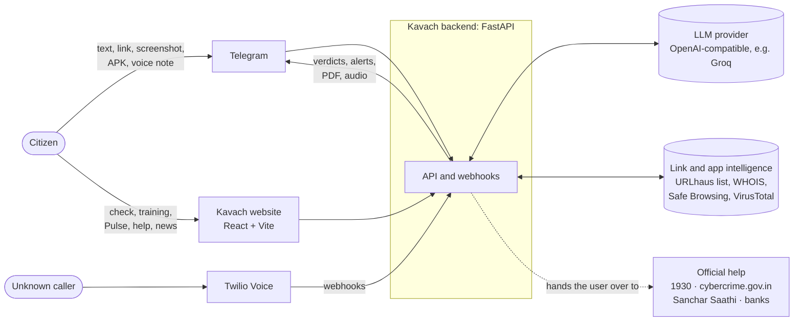
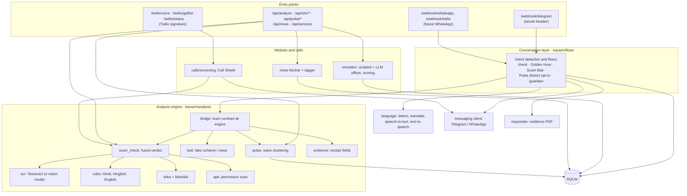
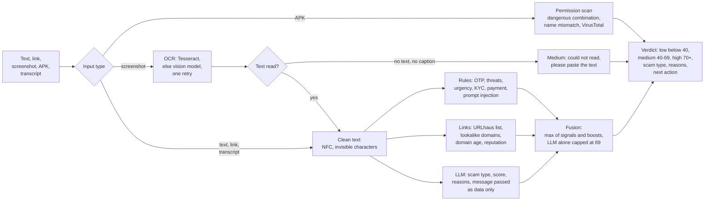
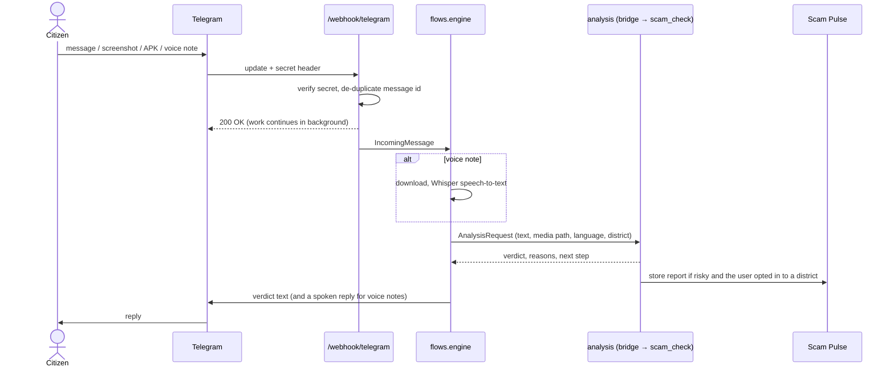
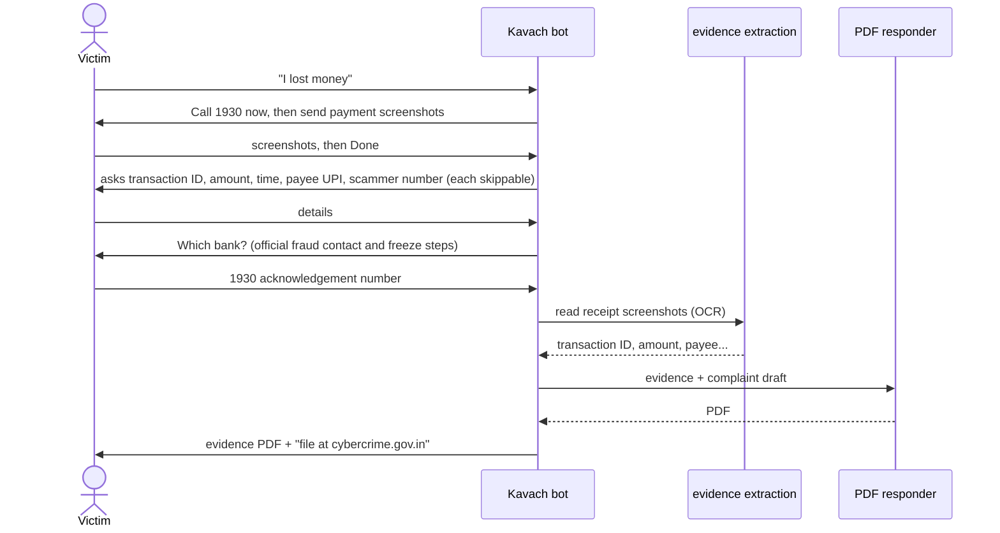
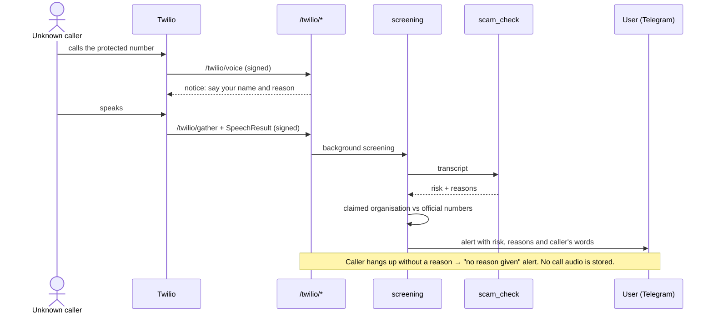
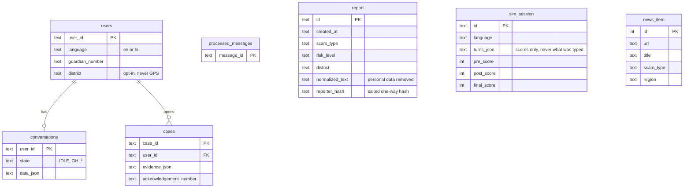

# Kavach: Technical Design Document

**Team Padmavyuh** (Krishna Mohan, Vani Karre, Dhanushiya S) · Hack for Social Cause · Theme: Digital Safety & Cyber Fraud Awareness

## 1. Purpose and scope

Kavach protects citizens before, during and after a cyber scam:

- **Before:** a scam-call training simulator and Scam Pulse alerts about new scam waves.
- **During:** a check for suspicious messages, links, screenshots, voice notes and Android apps (APKs), and Call Shield, which screens unknown phone calls.
- **After:** the Golden Hour Responder, which tells victims to call 1930 first, collects evidence and produces a complaint-ready PDF.

Kavach is a **pathway to official help, not a replacement** for it: every flow ends at the 1930 helpline, cybercrime.gov.in, Sanchar Saathi (Chakshu) or the user's bank.

Channels today: a **Telegram bot**, a **website**, and **Twilio phone calls** for Call Shield. A WhatsApp adapter exists in the code and is planned as the next channel. Languages: **English and Hindi**, including Hinglish.

## 2. System context

## 3. Architecture

One FastAPI application (`backend/kavach/main.py`) serves the bot webhooks, the website API, Call Shield and, in production, the built website.

| Module | Owner | Responsibility |
|---|---|---|
| `kavach/whatsapp/` (webhook, client, media) | Person 1 | Telegram and WhatsApp webhooks, sending text, buttons, documents and audio, media download, hourly cleanup |
| `kavach/flows/` | Person 1 | Intent detection, check flow, Golden Hour, Scam Bait, district opt-in |
| `kavach/language/` | Person 1 | Hindi/English detection, translation, Whisper speech-to-text, gTTS replies |
| `kavach/responder/` | Person 1 | Evidence PDF and bank contact data |
| `kavach/analysis/`, `kavach/llm.py` | Person 2 | Verdict engine, OCR, links, APK, Scam Bait, Pulse, evidence extraction, evaluation |
| `kavach/api/`, `kavach/simulator/`, `kavach/calls/` | Person 3 | Website API, training simulator, Call Shield |
| `web/` | Person 3 (UI redesign by Person 2) | Website: check, training, Pulse map, help, news |

## 4. Analysis engine

Every verdict combines three independent signals. The AI alone can never mark a message high risk.

- **Thresholds:** medium at 40, high at 70. They were tuned on the development set and recorded in `eval/report.md`.
- **No LLM or no internet:** rules and the offline blocklist still give a verdict, marked `confidence: lower`.
- **Hindi:** Hindi and Hinglish phrases sit in one reviewable block in `rules.py`. When the user chooses Hindi, the LLM writes its reasons and explanation in Hindi.
- **Prompt injection:** the message is quoted as data, and text aimed at AI checkers is itself a red flag.

## 5. Key flows

### 5.1 Check a message on Telegram

### 5.2 Golden Hour: after money is lost

### 5.3 Call Shield

### 5.4 Website

The website calls the same backend through `/api/*`.

- **Check a message:** text, link, screenshot or APK upload, at most 20 MB. Uploads are deleted right after the check.
- **Training:** a quiz before → a scam call with a fictional officer, where the LLM improvises inside a fixed script with an output guard → a quiz after → resilience score and debrief.
- **Scam Pulse:** a map of scam-wave alerts. The demo replay needs `DEMO_MODE=1`.
- **News:** RSS feeds tagged by scam type, or the hand-picked articles, labelled as demo.
- **Get help:** official services by situation.

If the backend is unreachable, the website shows clearly labelled sample data instead of a blank page.

## 6. Data model (SQLite)

## 7. API reference

| Method and path | Purpose | Protection |
|---|---|---|
| `POST /webhook/telegram` | Telegram updates | `X-Telegram-Bot-Api-Secret-Token`, message de-duplication |
| `GET/POST /webhook/whatsapp`, `POST /webhook/twilio` | WhatsApp (future) | Meta verify token / provider switch |
| `POST /api/analyze` | Check text, a link or an upload | 30 requests/min per IP, 20 MB cap, real-image check, 28 s timeout |
| `POST /api/sim/start`, `/turn`, `/quiz` | Training simulator | 60 requests/min per IP, 500-character replies, real-ID-number stop |
| `GET /api/pulse/alerts`, `POST /api/pulse/replay` | Scam Pulse | Replay only when `DEMO_MODE=1` |
| `GET /api/news`, `GET /api/services` | News and official help | Only `http(s)` links are returned |
| `POST /twilio/voice`, `/gather`, `/status` | Call Shield | Twilio request signature (`TWILIO_AUTH_TOKEN`) |
| `GET /health` | Health check | none |

Every `/api/*` error uses the format `{"error": "<code>", "message": "<plain text>"}`. Internal details are never returned to the user.

## 8. Security and privacy

- **Secrets:** credentials live only in `backend/.env`, which git ignores.
- **Verified webhooks:** the Telegram secret and the Twilio signature are checked with constant-time comparison.
- **Personal data:**
  - website uploads are deleted after each check, and bot media is deleted after 24 hours;
  - no call audio is stored;
  - Scam Pulse keeps only normalised text, with phone numbers, UPI IDs and amounts removed, plus a salted one-way hash of the reporter;
  - the simulator keeps scores, never what the user typed.
- **Location:** a district for Scam Pulse is collected only when the user sends `district <name>`. GPS is never collected.
- **AI safety:**
  - messages are passed to the LLM as data, and injection attempts are flagged;
  - the LLM alone cannot reach high risk;
  - the simulator never names real agencies or banks, and stops if ID-like numbers are typed.
- **Legal:** the design aims at privacy by design under the DPDP Act 2023. Kavach is a prototype, not an official government service.

## 9. Technology stack

| Layer | Technology |
|---|---|
| Backend | Python 3.11+, FastAPI, Uvicorn, SQLite, Pydantic |
| AI | OpenAI-compatible LLM (Groq `openai/gpt-oss-120b`), vision OCR (`qwen/qwen3.8-27b`), scikit-learn TF-IDF or multilingual-e5 for Pulse |
| Analysis | Tesseract OCR, androguard, rapidfuzz, tldextract, python-whois, URLhaus list, optional Safe Browsing and VirusTotal |
| Language and voice | langdetect, deep-translator, faster-whisper (Whisper base), gTTS |
| Messaging | Telegram Bot API (current), WhatsApp Cloud API and Twilio WhatsApp (future), Twilio Voice for Call Shield |
| Documents | ReportLab (evidence PDF) |
| Website | React 19, Vite, react-router, react-leaflet |
| Deployment | Linux VM, Nginx with HTTPS, systemd service (`backend/docs/deploy.md`) |

## 10. Testing and evaluation

- **Automated tests:** 290 backend tests (analysis, Hindi, OCR, links, APK, Pulse, flows, website API, simulator, Call Shield) and 15 website tests. See [TEST_CASES.md](TEST_CASES.md).
- **End-to-end check:** 31 checks run the Telegram bot (with Telegram's servers simulated), the website API and Call Shield, together with the real LLM.
- **Accuracy (sealed test sets, written before their first run):**
  - English: 9 of 10 scams caught, 0 false alarms in 12 genuine messages;
  - Hindi: 12 of 12 caught, 1 false alarm in 12.

  Full numbers are in [eval/report.md](../eval/report.md).

## 11. Deployment

A single VM runs Uvicorn behind Nginx with HTTPS, managed by systemd. The Telegram webhook points at `https://<host>/webhook/telegram`, and the Twilio number's voice webhook points at `https://<host>/twilio/voice`. `npm run build` produces `web/dist`, which the backend serves at `/`. Step-by-step instructions are in [backend/docs/deploy.md](../backend/docs/deploy.md).

## 12. Limitations and future work

- **WhatsApp:** the adapter exists; the next step is moving the demo from Telegram to WhatsApp.
- **News:** shows hand-picked articles until `NEWS_FEEDS` is configured.
- **Languages:** Tamil and other Indian languages are on the roadmap. The engine already recognises Tamil scam words, but Tamil is not offered to users yet.
- **Small evaluation sets:** one message changes recall by several points. Messages written by people outside the team would be a fairer test.
- **Call Shield:** the official-number list currently covers a few organisations, and every entry needs checking against official sources.
- More limitations are in [LIMITATIONS.md](LIMITATIONS.md).
